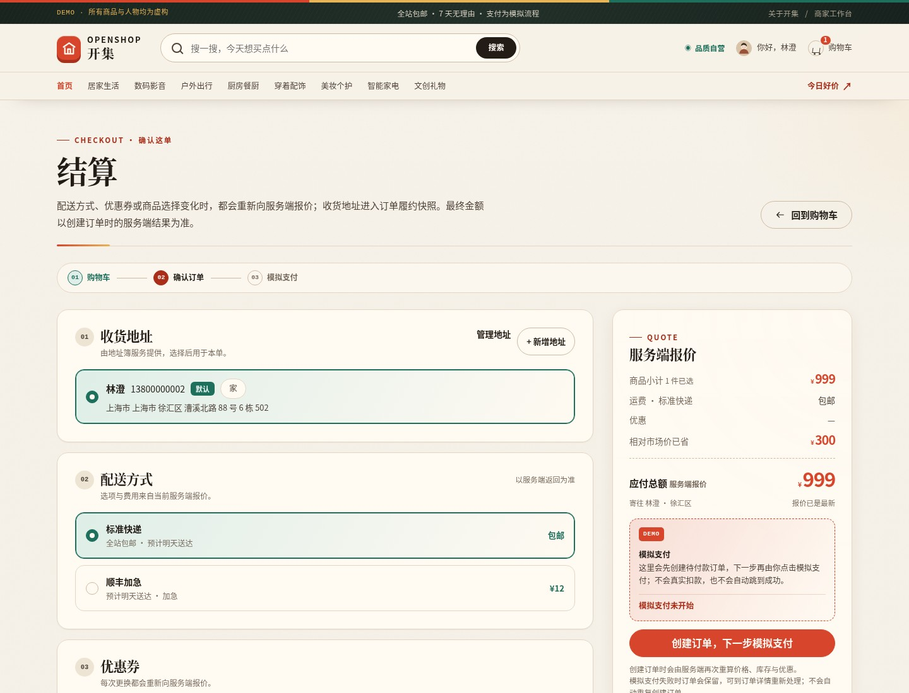
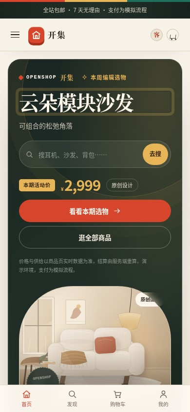

# OpenShop · 开集

> 逛得开，买得值。

OpenShop（开集）是一个可自托管、可审阅的开源多边电商参考实现。它把**官方自营、品牌旗舰、源头工厂**三种供给放进同一套发现、比较、下单与售后体验里：同一件商品可以并排比较谁发货、多久到、贵在哪里。当前种子包含 18 件虚构商品、10 家虚构店铺和 54 条示例评价。

后端只依赖 Python 标准库与 SQLite，前端为原生 ES Module。没有构建步骤、第三方运行时依赖、CDN、外部字体或分析脚本，便于本地运行和代码审阅。

**状态（2026-10-13）：v0.1.0 本地可运行验收版。** 真实 API 验收 35/35、真实 Chromium 端到端 11/11 阶段通过，固定仓库门 PASS；13 张验收截图覆盖浏览、加购、结算、模拟支付、商家发货、买家收货和评价。当前**只在本地运行，未公开部署、未推送远端仓库**。

> **真实边界**：全部商品、品牌、店铺、人物、评价与订单均为虚构演示数据；支付是明确标注的模拟流程，不产生真实扣款；这是**非生产级**单进程参考实现，不提供生产级容量、可用性或安全承诺，也未在公网发布。

## 界面

| 首页 | 商品详情 |
| --- | --- |
|  |  |

| 结算 | 商家工作台 |
| --- | --- |
|  |  |

<details>
<summary>移动端首页截图（390 × 844）</summary>



</details>

截图由真实本地服务和 Chromium 生成，不含 mock 后端。完整 13 张验收截图位于测试证据目录（路径见 [docs/testing.md](docs/testing.md)）。

## 快速开始

前置条件：**Python 3.10+**（含标准库 `sqlite3`）。运行应用不需要 Node、npm 或 pip；系统 Node 只被开发期的仓库门用于 JavaScript 语法检查。

在仓库根目录执行，显式指定独立数据目录与固定端口：

```bash
python3 -B apps/storefront/server.py --host 127.0.0.1 --port 8780 --data-dir "$HOME/.local/share/openshop-demo"
```

打开 <http://127.0.0.1:8780/>。首次启动会在 `--data-dir` 指定目录创建 `openshop.sqlite3` 并幂等播种；请使用仓库外的独立目录，不要把运行数据库提交进 Git。

健康检查：

```bash
curl -fsS http://127.0.0.1:8780/healthz
curl -fsS http://127.0.0.1:8780/api/health
```

第一条应输出 `ok`，第二条返回含 `"demo":true` 的 JSON。更完整的本地安装、数据目录与故障排查见 [docs/INSTALL.md](docs/INSTALL.md)。

### 演示账号

演示账号通过右上角登录浮层的一键演示进入，不需要也不应输入密码。所有身份均为虚构人物：

| 角色 | handle | 显示名 | 用途 |
| --- | --- | --- | --- |
| 买家 | `demo_buyer` | 林澄 | 浏览、购物车、模拟结算、订单与评价 |
| 第二位买家 | `demo_buyer_two` | 许岚 | 验证真实拼团第二人加入 |
| 商家 | `demo_seller` | 周屿 | OpenShop 自营的库存、发货与售后处理 |

演示登录只会选择种子中的这些账号。不要录入真实姓名、地址、电话或任何凭据。

## 三种供给与功能范围

| 供给 | offer 类型 | 特点 | 购买方式 |
| --- | --- | --- | --- |
| 官方自营 | `self` | 官方选品、单一履约责任、仓配直达 | 普通购买；部分报价支持拼团 |
| 品牌旗舰 | `brand` | 品牌店铺直营，品牌仓发货与售后 | 普通购买；部分报价支持拼团 |
| 源头工厂 | `factory` | 工厂直供给出更低价格，通常集单发货 | 普通购买；部分报价支持拼团 |

**拼团是 offer 级能力，不是某一种店铺的专利**：是否支持拼团由每个报价的 `group_size` 与 `group_price_cents` 决定；页面和接口按真实配置展示。

已实现并通过本轮验收的范围：

- **发现与比较**：首页、分类、搜索、筛选排序、商品详情、图集、SKU、店铺信息、评价读取；同一件商品比较不同供给的价格、配送与服务。
- **买方闭环**：游客购物车、一键演示登录与注册、地址簿、优惠券、服务端结算报价、模拟支付、订单与包裹、物流时间线、取消、确认收货和评价。
- **真实拼团**：邀请码参团；公开进度只统计已付款成员；未满团不显示成团成功；查看、参与和支付路径都会校验团状态与 `expires_at`。**当前没有后台定时到期清理/自动退款任务**，该边界不会被 UI 伪装成已发生。
- **售后与商家台**：整单且仅单店铺的模拟退款申请与商家审批；商家只能操作自己店铺的库存、发货和售后，只能看到掩码后的买家身份，不返回完整地址。
- **明确不做**：真实资金、真实物流、身份/KYC、风控、推荐模型训练、多实例分布式事务和自动结算；没有生产容量与并发 SLA。

### 架构概览

```text
Browser (vanilla ES modules, same-origin fetch)
  -> apps/storefront/server.py        Python 标准库 ThreadingHTTPServer
       -> apps/storefront/routes/     auth/catalog, trade, seller JSON API
       -> packages/commerce/          领域逻辑、服务端计价、鉴权、种子
       -> SQLite (WAL)                --data-dir 下的单文件持久化
```

同一来源同时提供 `/api` JSON、静态 `web/` 资源与健康检查。价格、优惠、库存和订单可执行状态均由服务端重算/判定；写请求要求会话 Cookie 与 CSRF 头；响应带 CSP 等安全头，页面不使用内联脚本或第三方资源。详细分层、请求生命周期和安全边界见 [docs/architecture.md](docs/architecture.md)，冻结的接口与数据约定见 [docs/api-contract.md](docs/api-contract.md) 和 [docs/data-contract.md](docs/data-contract.md)。

支付接口只接受 `payment_method="demo"`，返回的元信息带 `demo:true`。任何“完成支付”都只代表模拟状态流转。

## 测试与仓库门

```bash
python3 -B tools/smoke_server.py
python3 -B -m unittest discover -s tests -v
python3 -B tools/check_repository.py --selftest
python3 -B tools/check_repository.py --check
```

- 标准库测试默认把隔离数据写到系统临时目录；可用 `OPENSHOP_TMP_BASE`、`OPENSHOP_CATALOG_TEST_PORT`、`OPENSHOP_TRADE_TEST_PORT`、`OPENSHOP_SELLER_TEST_PORT` 覆盖。当前 CI 路径下 21 个测试全部通过。
- 仓库门已现读 **PASS**：19 项检查 0 failures（1 个非阻断 warning：GitHub Actions 的 checkout action 使用 tag 而非 SHA 固定）。`--selftest` 带 19 个负控。
- 完整真实浏览器验收由 `tools/qa/run_acceptance.py` 编排，使用真实后端、真实 Chromium、真实 cookie/CSRF 和 SQLite；本轮为 **API 35 PASS / 0 FAIL、浏览器 11 PASS / 0 FAIL、13 张截图、0 控制台错误、0 外链请求、0 横向溢出**。命令、机器依赖和证据路径见 [docs/testing.md](docs/testing.md)。
- 仓库门需要系统 `node` 做 JS 语法检查；运行产品本身不需要 Node。
- 安全说明见 [SECURITY.md](SECURITY.md)，独立审查与修复记录见 [docs/peer-review-core-api.md](docs/peer-review-core-api.md)。

### 已知限制

- 完整三轮并发专项套件因执行该任务的 agent 回合基础设施失败而**未交付**；已有的真实并发探针覆盖“库存=1 抢购、并发幂等、拼团容量”（见测试文档），但不宣称完成全套并发压测。
- 拼团过期只能在查看/参与/支付路径被拒绝，没有后台自动取消和退款任务。
- 售后目前只支持整单单店铺；多店铺退货退款不在 MVP 内。
- 未做真实支付、真实物流、KYC、生产容量、TLS 终结、跨实例会话/限速和灾备。
- **未公开部署、未推送远端仓库**：这需要明确的生产发布/仓库发布授权与入口配置。

## 目录

| 路径 | 用途 |
| --- | --- |
| `apps/storefront/` | HTTP 服务、路由注册与静态资源入口 |
| `packages/commerce/` | SQLite schema/种子、领域模型、鉴权、服务端报价 |
| `web/` | 无构建步骤的 ES Module 前端、本地 CSS 与原创 SVG |
| `data/` | 可审阅的虚构商品、店铺、人物与生成规则 |
| `tests/` | 标准库验收测试入口；发布时必须由 CI 实际发现并运行 |
| `docs/` | 产品、架构、API/数据契约、安装、开源与发布流程 |
| `tools/` | 仓库门与本地烟雾测试工具 |
| `deploy/` | 非 root systemd 模板、健康检查与安装/回滚样例 |
| `.github/workflows/` | 最小权限、无凭据、无网络安装的 CI |

目录表对应当前可运行版本；测试、仓库门和真实浏览器验收均随交付保留。运行数据不进入 Git。

## 参与与安全

贡献方式见 [CONTRIBUTING.md](CONTRIBUTING.md)。安全问题请不要开公开 issue，按 [SECURITY.md](SECURITY.md) 私下联系维护者。社区行为准则见 [CODE_OF_CONDUCT.md](CODE_OF_CONDUCT.md)；开源边界、素材来源和第三方依赖政策见 [docs/OPEN-SOURCE.md](docs/OPEN-SOURCE.md)；变更记录见 [CHANGELOG.md](CHANGELOG.md)。

生产安装、TLS 入口、公网发布和远端仓库推送均未在本仓库任务中执行。`deploy/` 只是需要单独授权的模板，不会自动触碰任何既有服务、DNS、证书或反向代理。

## 许可

代码与仓库内原创文档/素材以 [Apache License 2.0](LICENSE) 发布。OpenShop、开集品牌、商品、店铺、人物、评价和所有视觉素材均为项目原创或虚构，不代表任何真实主体，也不使用第三方平台的商标、截图或商品图片。

## English

OpenShop is an audit-friendly, self-hosted open-source marketplace reference implementation: three offer types, real group-buying state, a stdlib-only Python backend, SQLite, and vanilla ES modules with no build step or third-party runtime dependencies. The fictional seed includes 18 products, 10 shops and 54 reviews. Local acceptance passed 35 real-HTTP API checks and 11 real-Chromium browser stages; payments are still simulated and all catalog identities are fictional. This is not a production-scale service, and it has not been publicly deployed or pushed to a remote repository. See [docs/INSTALL.md](docs/INSTALL.md) and [docs/testing.md](docs/testing.md). Licensed under Apache-2.0.
