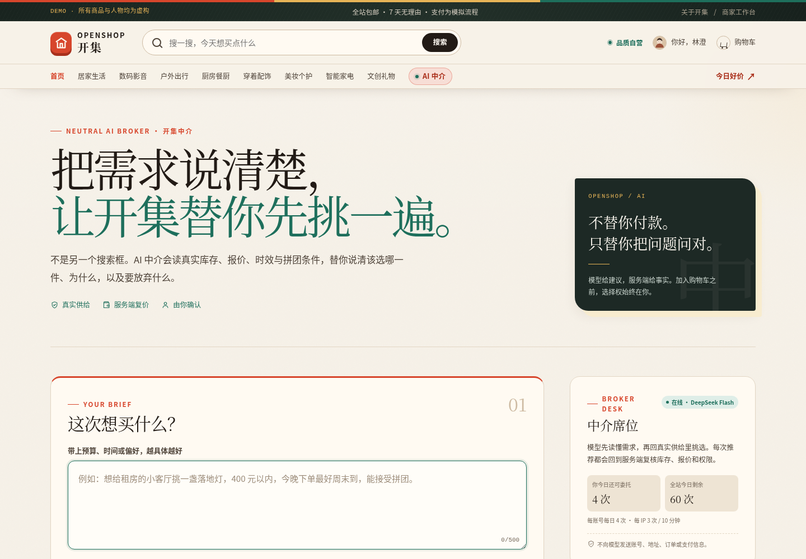
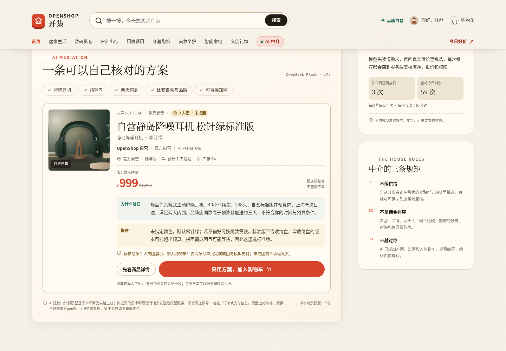
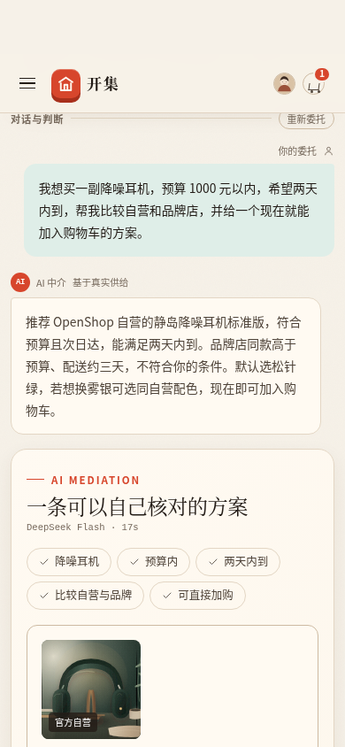
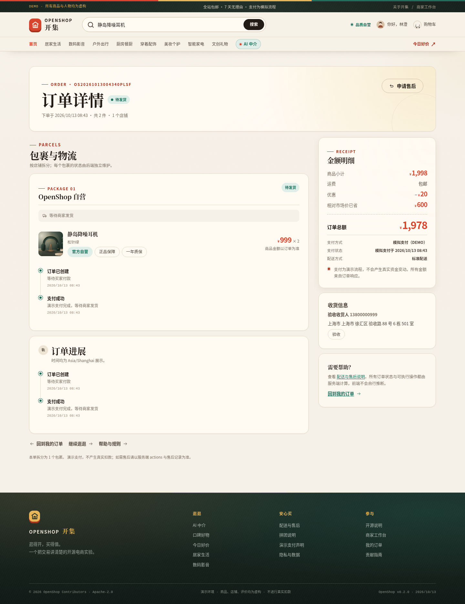

# OpenShop · 开集

> 逛得开，买得值。

OpenShop（开集）是一个可自托管、可审阅的开源多边电商参考实现。它把**官方自营、品牌旗舰、源头工厂**三种供给放进同一套发现、比较、下单与售后体验里：同一件商品可以并排比较谁发货、多久到、贵在哪里；再用**中立的 AI 买手中介**把这些真实供给翻译成买家能确认的购物方案。当前种子包含 18 件虚构商品、10 家虚构店铺和 54 条示例评价。

后端只依赖 Python 标准库与 SQLite，前端为原生 ES Module。没有构建步骤、第三方运行时依赖、CDN、外部字体或分析脚本，便于本地运行和代码审阅。AI 中介可在服务端选择接入 OpenAI 兼容模型网关；浏览器本身仍不加载任何外链。

**状态（2026-10-13）：v0.2.0 公网演示在线。** 公开入口：<https://openshop.ai4everyone.top/>（HTTPS + HSTS + CSP；服务绑定受限 systemd 网络白名单，边缘仅由两台上游代理访问）。验证：API 35/35、Chromium 11/11（并已在公网再次跑通完整购物 11/11）、**29 个标准库测试**、3×7 并发、**44/44 安全探针**、仓库门 PASS；真实 deepseek-flash 模型在公网完成了 **AI 中介：自然语言 → 真实目录 → 服务端复价 → 确认加购**，Secure/HttpOnly Cookie、HSTS、0 console/page/外链错误。部署、回滚与现读证据见 [docs/STATUS.md](docs/STATUS.md) 和 [docs/deployment.md](docs/deployment.md)。这是非生产级演示，不提供 SLA。

- **公开只读源码**：<https://openshop.ai4everyone.top/web/source/openshop-0.2.0.tar.gz>（同名 `.sha256` 紧邻可查），从最终 tag 生成；完整本地 Git 提交与 SHA 见本仓记录和最终交接。**没有 push 到外部 GitHub/Gitee，也没有远端 CI 实跑**：现有 GitHub 凭据被限定在既有 OpenMath 私有仓，Gitee SSH 只能访问既有仓，且没有新建公开仓库的显式目标/凭据；未绕过该凭据边界。

> **真实边界**：全部商品、品牌、店铺、人物、评价与订单均为虚构演示数据；支付是明确标注的模拟流程，不产生真实扣款；AI 推荐受外部模型、网络和配额影响，不能替代服务端价格与库存事实；这是**非生产级**单进程参考实现，不提供生产级容量、可用性或安全承诺。

## 界面

| 首页 | 商品详情 |
| --- | --- |
|  |  |

| 结算 | 商家工作台 |
| --- | --- |
|  |  |

<details>
<summary>移动端首页截图（390 × 844）</summary>


</details>

### AI 中介（公网真实模型）

| AI 页面 | 真实模型方案 |
| --- | --- |
|  |  |





原有购物截图由真实本地服务和 Chromium 生成；AI 页面截图和上面的订单页来自 `https://openshop.ai4everyone.top/` 的公开 HTTPS、真实账户/数据和真实模型运行，不是 mock。公网全购物旅程与 AI 的完整证据路径见 [docs/testing.md](docs/testing.md)。

## 快速开始

前置条件：**Python 3.10+**（含标准库 `sqlite3`）。运行应用不需要 Node、npm 或 pip；系统 Node 只被开发期的仓库门用于 JavaScript 语法检查。

在仓库根目录执行，显式指定独立数据目录与固定端口：

```bash
python3 -B apps/storefront/server.py --host 127.0.0.1 --port 8780 --data-dir "$HOME/.local/share/openshop-demo"
```

打开 <http://127.0.0.1:8780/>。首次启动会在 `--data-dir` 指定目录创建 `openshop.sqlite3` 并幂等播种；请使用仓库外的独立目录，不要把运行数据库提交进 Git。

健康检查：

```bash
curl -fsS http://127.0.0.1:8780/healthz
curl -fsS http://127.0.0.1:8780/api/health
```

第一条应输出 `ok`，第二条返回含 `"demo":true` 的 JSON。更完整的本地安装、数据目录与故障排查见 [docs/INSTALL.md](docs/INSTALL.md)。

### 演示账号

演示账号通过右上角登录浮层的一键演示进入，不需要也不应输入密码。所有身份均为虚构人物：

| 角色 | handle | 显示名 | 用途 |
| --- | --- | --- | --- |
| 买家 | `demo_buyer` | 林澄 | 浏览、购物车、模拟结算、订单与评价 |
| 第二位买家 | `demo_buyer_two` | 许岚 | 验证真实拼团第二人加入 |
| 商家 | `demo_seller` | 周屿 | OpenShop 自营的库存、发货与售后处理 |

演示登录只会选择种子中的这些账号。不要录入真实姓名、地址、电话或任何凭据。

## 三种供给与功能范围

| 供给 | offer 类型 | 特点 | 购买方式 |
| --- | --- | --- | --- |
| 官方自营 | `self` | 官方选品、单一履约责任、仓配直达 | 普通购买；部分报价支持拼团 |
| 品牌旗舰 | `brand` | 品牌店铺直营，品牌仓发货与售后 | 普通购买；部分报价支持拼团 |
| 源头工厂 | `factory` | 工厂直供给出更低价格，通常集单发货 | 普通购买；部分报价支持拼团 |

**拼团是 offer 级能力，不是某一种店铺的专利**：是否支持拼团由每个报价的 `group_size` 与 `group_price_cents` 决定；页面和接口按真实配置展示。

已实现并通过本轮验收的范围：

- **发现与比较**：首页、分类、搜索、筛选排序、商品详情、图集、SKU、店铺信息、评价读取；同一件商品比较不同供给的价格、配送与服务。
- **买方闭环**：游客购物车、一键演示登录与注册、地址簿、优惠券、服务端结算报价、模拟支付、订单与包裹、物流时间线、取消、确认收货和评价。
- **真实拼团**：邀请码参团；公开进度只统计已付款成员；未满团不显示成团成功；查看、参与和支付路径都会校验团状态与 `expires_at`。**当前没有后台定时到期清理/自动退款任务**，该边界不会被 UI 伪装成已发生。
- **售后与商家台**：整单且仅单店铺的模拟退款申请与商家审批；商家只能操作自己店铺的库存、发货和售后，只能看到掩码后的买家身份，不返回完整地址。
- **AI 中介**：登录买家可用自然语言委托，AI 只从服务端真实 offer/SKU 中推荐一件主选与有限替代项，解释取舍；服务端复价、绑定用户的一次性方案与确认加购，不自动支付。未配置模型时明确关闭，限额、超时、限流和模型失败都有显式错误态；详见 [docs/ai-mediator.md](docs/ai-mediator.md)。
- **明确不做**：真实资金、真实物流、身份/KYC、风控、推荐模型训练、多实例分布式事务和自动结算；AI 不自动下单/支付，也没有生产容量与并发 SLA。

### AI 中介

[AI 中介页](docs/ai-mediator.md) 是站内 `/ai`：买家说出需求后，服务端把真实商品、报价、SKU、库存、时效与拼团条件交给可选的 OpenAI 兼容模型；模型只能返回 JSON 候选，服务端复核供给 ID 并重新取价，形成一次性、登录用户绑定、15 分钟有效的方案。用户确认采纳后仍走现有购物车规则，不会自动建单或支付。未配置模型时页面明确显示未启用；请求受每日、每用户、每 IP 和并发上限约束。AI 会收到本次委托与最近对话，不接收账号、地址、订单或支付信息。

### 架构概览

```text
Browser (vanilla ES modules, same-origin fetch)
  -> apps/storefront/server.py        Python 标准库 ThreadingHTTPServer
       -> apps/storefront/routes/     auth/catalog, trade, seller, AI JSON API
       -> packages/commerce/          领域逻辑、服务端计价、鉴权、种子
       -> packages/commerce/ai_*.py  供给快照、模型校验、配额与一次性方案
       -> 可选 OpenAI-compatible AI gateway（仅服务端出站，浏览器不外链）
       -> SQLite (WAL)                --data-dir 下的单文件持久化
```

同一来源同时提供 `/api` JSON、静态 `web/` 资源与健康检查。价格、优惠、库存和订单可执行状态均由服务端重算/判定；AI 中介只发送公开供给与买家本次委托/最近对话给模型，推荐中的供给 ID 再回到 SQLite 校验并复价。写请求要求会话 Cookie 与 CSRF 头；响应带 CSP 等安全头，页面不使用内联脚本或第三方资源。详细分层、请求生命周期和安全边界见 [docs/architecture.md](docs/architecture.md)，冻结的接口与数据约定见 [docs/api-contract.md](docs/api-contract.md) 和 [docs/data-contract.md](docs/data-contract.md)，AI 设计与部署配置见 [docs/ai-mediator.md](docs/ai-mediator.md)。

支付接口只接受 `payment_method="demo"`，返回的元信息带 `demo:true`。任何“完成支付”都只代表模拟状态流转。

## 测试与仓库门

```bash
python3 -B tools/smoke_server.py
python3 -B -m unittest discover -s tests -v
python3 -B tests/test_trade_concurrency.py
python3 -B tests/test_ai_mediator.py -v
python3 -B tests/test_peer_review_probes.py
python3 -B tools/check_repository.py --selftest
python3 -B tools/check_repository.py --check
```

本地发布归档与负控另见 [docs/RELEASE-REHEARSAL.md](docs/RELEASE-REHEARSAL.md) 和 `python3 -B tools/rehearse_release.py --help`。

- 标准库测试默认把隔离数据写到系统临时目录；可用 `OPENSHOP_TMP_BASE`、`OPENSHOP_CATALOG_TEST_PORT`、`OPENSHOP_TRADE_TEST_PORT`、`OPENSHOP_SELLER_TEST_PORT` 覆盖。本轮为 **29 tests PASS**：原有 22 项 + AI 假 provider 的真实 HTTP/安全集成测试与辅助测试 3 项 + 可信代理 IP 单测 4 项。
- 并发验收在全新数据目录上用真实 HTTP 连续跑 **3 轮 × 7 场景**：8 并发抢 1 件库存、并发幂等建单、券领取/核销竞态、拼团名额与支付竞态、取消竞态、pay/cancel 竞态。可用 `OPENSHOP_CONCURRENCY_TEST_PORT`、`OPENSHOP_CONCURRENCY_EVIDENCE_ROOT` 覆盖端口与证据目录。
- 独立安全审查：**44/44 probes PASS，39/39 controls PASS，5/5 findings 修复可回归**。限速控制通过同库原地进程重启获得干净额度，seller 权限由 guest 401、buyer 403、seller 200 + 自身店铺匹配验证；完整原始记录见 [docs/peer-review-core-api.md](docs/peer-review-core-api.md)。
- 仓库门已现读 **PASS**：19 项检查 0 failures（2 个非阻断 warnings：GitHub Actions checkout 按 tag 固定；离线门不抓取 README 内本站 source 外链）。`--selftest` 带 19 个仓库门负控；发布演练另有 10 个负控全部通过。
- 完整真实浏览器验收由 `tools/qa/run_acceptance.py` 编排，使用真实后端、真实 Chromium、真实 cookie/CSRF 和 SQLite；本轮本地为 **API 35 PASS / 0 FAIL、浏览器 11 PASS / 0 FAIL、13 张截图、0 控制台错误、0 外链请求、0 横向溢出**。
- **公网全购物旅程**：同一套真实 Chromium 以 `--allow-public-host` 显式授权目标 `openshop.ai4everyone.top`，在线上完成搜索→商品→加购→登录合并→新地址/优惠券→服务端报价→模拟支付→商家发货→买家确认收货→评价，以及 390px 移动订单页；**11/11 PASS、13 张公网截图、0 console/page/外链错误**。订单 `OS20261013004340PLSF`。证据：`/hf3fs-jd/data/tmp/openshop/deploy/public-full-e2e-20261013T084320/`。
- 另有真实浏览器补验：真实自营拼团由 1/2 已付款发起，再以第二位真实注册买家经 UI 参团并付款到 **FULL 2/2**；商家工作台经 UI 把报价库存从 **26 改为 27**，PATCH 200 且刷新后持久化。浏览器错误 0。
- **AI 真实链路**：真实 deepseek-flash 模型完成从自然语言委托到真实 offer/SKU 校验、服务端复价与一次性方案的中介调用；本地与公网 HTTP 验收均验证 CSRF 403、未登录 401、模型仅被调用一次、方案采纳购物车增加、方案复用 409、**订单数仍为 0**；公网真实 Chromium 完成登录→AI→采纳链路，17.3 秒模型调用、Secure/HttpOnly 会话 Cookie、HSTS/CSP 通过，桌面/390px 无溢出，0 console/page/外链错误。失败也保留：1,100 输出 token 上限曾返回空 content，服务端正确拒绝而未伪造结果；一次证据写出路径不可写导致验收退出，已换可写目录重跑并保留边界。详见 [docs/ai-mediator.md](docs/ai-mediator.md) 与 [docs/testing.md](docs/testing.md)。
- CI 配置会依次执行标准库测试（含 AI 假 provider 的真实 HTTP 集成测试）、真实三轮并发验收、44 探针安全审计、仓库门自检和仓库门；本轮在本机模拟同一命令全绿。**远端 GitHub Actions 尚未实际触发**，且公开源码暂通过本站只读归档而非外部 Git 托管提供；这是明确的剩余发布边界。
- 仓库门需要系统 `node` 做 JS 语法检查；运行产品本身不需要 Node。
- 安全说明见 [SECURITY.md](SECURITY.md)，独立审查与修复记录见 [docs/peer-review-core-api.md](docs/peer-review-core-api.md)。

### 已知限制

- AI 中介依赖外部 OpenAI 兼容模型网络与已授权配额；模型不可用时会显式失败，不会用假回答兜底。公网冷调用约 17–19 秒，未做流式输出；线上限额为每账号每日 4 次、每 IP 3 次/10 分钟、全站每日 60 次。
- AI 的全局/每用户额度写入 SQLite，每 IP 窗口和方案存储是**单进程内存**：重启会清空方案和 IP 窗口，不适用于多实例部署；外部模型可能产生不精确的定性描述，服务端价格/库存/供给身份才是事实来源。
- 三轮并发验收覆盖 7 个场景，但只针对**单进程 SQLite、单机 loopback、直接 DB 构造的 fixture**；不覆盖多进程/多机、文件系统或锁超时、卖家售后审批并发、拼团过期并发，也不构成性能/容量压测或 SLA。
- 拼团过期只能在查看/参与/支付路径被拒绝，没有后台自动取消和退款任务。
- 售后目前只支持整单单店铺；多店铺退货退款不在 MVP 内。
- 未做真实支付、真实物流、KYC、生产容量、跨实例会话/限速和灾备；TLS 由现有 infra Caddy 边缘终结，证书/HSTS 已有现读证据，但不构成生产安全或 SLA 认证。
- **公网入口和本站源码归档已发布；未创建外部 GitHub/Gitee 新仓库、未 push、未跑远端 CI**。现有公开 Git 写入链没有可用于新建 OpenShop 仓库的授权目标/凭据，未绕过既有凭据边界。需要维护者提供目标远端或授权后才能迁移到外部 Git 托管。
- 运行环境使用 systemd 网络地址白名单和可信反代 IP 解析；这些是单机控制，不是 DDoS 防护或分布式配额。

## 目录

| 路径 | 用途 |
| --- | --- |
| `apps/storefront/` | HTTP 服务、路由注册与静态资源入口 |
| `packages/commerce/` | SQLite schema/种子、领域模型、鉴权、服务端报价 |
| `web/` | 无构建步骤的 ES Module 前端、本地 CSS 与原创 SVG |
| `data/` | 可审阅的虚构商品、店铺、人物与生成规则 |
| `tests/` | 标准库验收测试入口；发布时必须由 CI 实际发现并运行 |
| `docs/` | 产品、架构、API/数据契约、安装、开源与发布流程 |
| `tools/` | 仓库门与本地烟雾测试工具 |
| `deploy/` | 非 root systemd、AI 凭据/环境示例、健康检查与安装/回滚手册 |
| `.github/workflows/` | 最小权限、无凭据、无网络安装的 CI |

目录表对应当前可运行版本；测试、仓库门和真实浏览器验收均随交付保留。运行数据不进入 Git。

## 参与与安全

贡献方式见 [CONTRIBUTING.md](CONTRIBUTING.md)。安全问题请不要开公开 issue，按 [SECURITY.md](SECURITY.md) 私下联系维护者。社区行为准则见 [CODE_OF_CONDUCT.md](CODE_OF_CONDUCT.md)；开源边界、素材来源和第三方依赖政策见 [docs/OPEN-SOURCE.md](docs/OPEN-SOURCE.md)；变更记录见 [CHANGELOG.md](CHANGELOG.md)。

生产安装、DNS、Let’s Encrypt 证书、两台上游 Caddy 边缘和公网切换已于 **2026-10-13** 完成，详情、备份与回滚入口见 [docs/deployment.md](docs/deployment.md) 和 [docs/STATUS.md](docs/STATUS.md)。`deploy/` 记录的是本部署形式的配置与操作手册；**没有修改任何 oss-* 服务**。外部 Git 仓库和远端 CI 仍未发布，原因与精确边界见上。

公开只读源码归档：[openshop-0.2.0.tar.gz](https://openshop.ai4everyone.top/web/source/openshop-0.2.0.tar.gz) 与同名 `.sha256`。

## 许可

代码与仓库内原创文档/素材以 [Apache License 2.0](LICENSE) 发布。OpenShop、开集品牌、商品、店铺、人物、评价和所有视觉素材均为项目原创或虚构，不代表任何真实主体，也不使用第三方平台的商标、截图或商品图片。

## English

OpenShop is an audit-friendly, self-hosted open-source marketplace reference implementation: three offer types, real group-buying state, a grounded AI buying mediator, a stdlib-only Python backend, SQLite, and vanilla ES modules with no build step or third-party runtime dependencies for the browser. It is live at https://openshop.ai4everyone.top/ with HTTPS/HSTS. The fictional seed includes 18 products, 10 shops and 54 reviews. Acceptance passed 35 real-HTTP API checks, 11 real-Chromium stages both locally and again against the public deployment, a 44-probe security audit with 39 controls, a three-round seven-scenario concurrency suite, 29 standard-library tests, plus public-browser evidence of a complete search-to-review shopping journey, a completed two-person group buy, a persisted seller inventory update, and a live-model AI mediation-to-cart flow. A read-only source archive is available at https://openshop.ai4everyone.top/web/source/openshop-0.2.0.tar.gz; no external GitHub/Gitee repository or remote CI is claimed because no authorized create/push credential for a new repository was available, and existing scoped credentials were not bypassed. The AI endpoint requires an operator-provided OpenAI-compatible model gateway; prompts and recent conversation are disclosed to that provider. Payments are simulated and all catalog identities are fictional. Deployment and rollback evidence are recorded in docs/STATUS.md and docs/deployment.md; there is no production-scale, availability or capacity guarantee. See [docs/INSTALL.md](docs/INSTALL.md), [docs/ai-mediator.md](docs/ai-mediator.md) and [docs/testing.md](docs/testing.md). Licensed under Apache-2.0.
